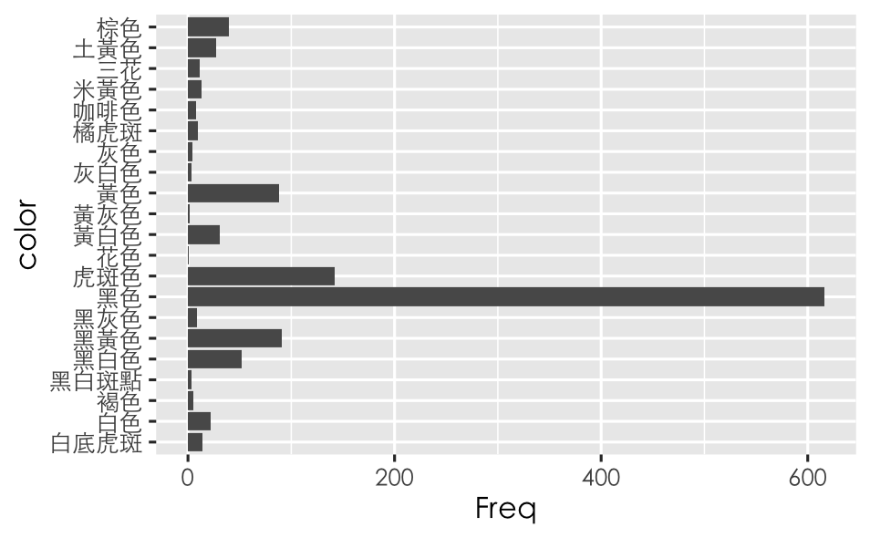
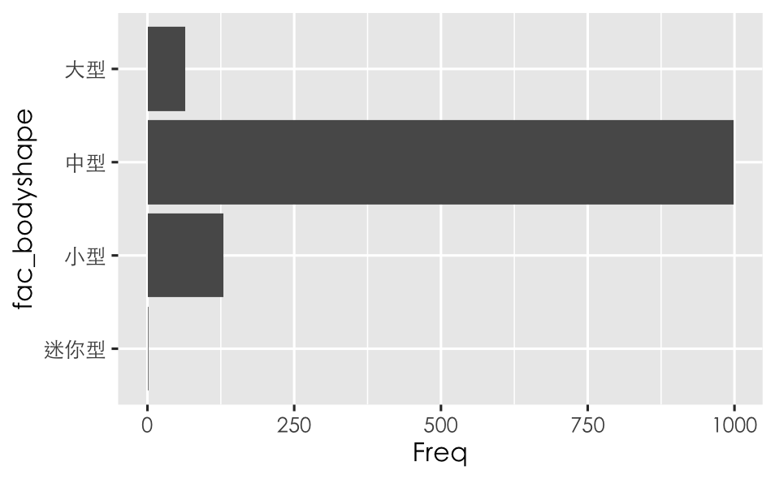
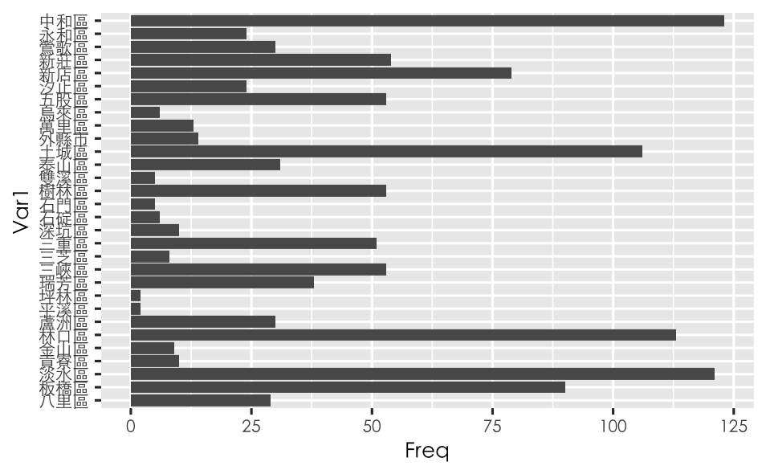
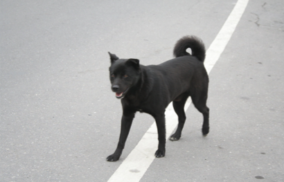
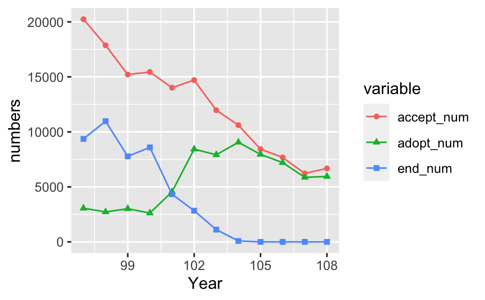

# New Taipei City Shelter Dogs: Who Is Waiting, and How Has It Changed?

An individual final project for *Programming for Data Science I* (National Taipei
University, Spring 2022, taught by Dr. Mau-Ting Lin). I volunteered at the Banqiao
Animal Shelter at the time, and wanted to understand two things:

1. **What types of dogs are most common in shelters?** A profile of 1,192 dogs listed on
   New Taipei City's adoption website.
2. **How has the shelter population changed over time?** A trend analysis of
   intake, adoption, and euthanasia from 2008 to 2019, using government open data.

---

## Data sources

| Dataset | Source | What it contains |
|---|---|---|
| Adoption listings (snapshot, April 2022) | [New Taipei City adoption website](https://act-adopt.ahiqo.ntpc.gov.tw/), collected by the instructor's [web crawler](https://github.com/tpemartin/110-2-R/blob/main/shelter_crawling.R) and shared with the class as [JSON](https://github.com/tpemartin/110-2-R/blob/main/animal_shelter.json) | 1,192 dogs, each with a free-text description and a photo |
| Shelter statistics, New Taipei City | Council of Agriculture open data API (`data.coa.gov.tw`) | Yearly and monthly counts of animals taken in, adopted, and euthanized |

## Part 1: What types of dogs are most common in shelters

### Course-provided code
Each listing stores all of its attributes in one free-text string
(e.g. `品種：混種 毛色：黑色 體型：中型 年齡：幼犬3個月 ...`). The code that turns
these strings into a data frame (the chunks in `final.Rmd` that import the JSON and build
`df_animalShelter`) is adapted
from the instructor's
[in-class demonstration](https://github.com/tpemartin/110-2-R/issues/14).

### My work
- **Standardized inconsistent values** before counting:
  - Ages such as "幼犬3個月" and "幼犬8個月" were collapsed into one life stage (young vs. adult)
  - Pickup addresses were truncated to the district level
  - Body size was set as an ordered factor (mini → small → medium → large) instead of
    being sorted alphabetically
- **Profiled each attribute** (coat color, breed, body size, age, reason for intake,
  pickup district) with frequency tables and bar charts in `ggplot2`

### What the data shows
The population is far more uniform than I expected. Across all 1,192 listings:

- 98.6% are mixed-breed (1,175 of 1,192); only 17 are purebred
- 83.7% are medium-sized; small and large dogs make up 10.8% and 5.4%
- 87.6% are adults; only 148 are young
- Just over half are black (51.7%), with tabby a distant second (11.9%)
- Five districts (Zhonghe, Tamsui, Linkou, Tucheng, and Banqiao) account for
  46.4% of all listings
- 65.9% entered the shelter through government capture; 6.1% of listings have no
  intake reason recorded

| Coat color | Body size | Pickup district |
|---|---|---|
|  |  |  |

### Putting the traits together: the black dog on the street
Each chart on its own shows the most common value of one trait. Putting the most
common values together (mixed-breed, medium-sized, adult, black) describes a dog
most people in Taiwan would recognize: the black street dog.



This profile is not just a coincidence of averages. **491 of the 1,192 dogs
(41.2%) match all four traits at once.** Many of the dogs waiting for a
home in New Taipei City look like the dogs people walk past every day.

## Part 2: How the shelter population has changed (2008–2019)

The adoption listings are a single snapshot, so I looked for a second data source
to see the longer-term picture. Using the API method from class, I pulled New Taipei
City's shelter statistics from the Council of Agriculture's open data platform.

### A data problem to solve first
The number of records per year was inconsistent:

| Years | Records per year |
|---|---|
| 2008–2012 | 1 |
| 2013–2019 | 13 |
| 2020–2021 | 12 |
| 2022 (partial year) | 4 |

Looking at the `rpt_month` field showed why. Records with `rpt_month = 0` are
**annual totals**, while months 1–12 are monthly figures. Summing every record in a
year would count the same animals twice. I therefore kept only the annual-total
records, which exist for 2008–2019 (2020–2021 have no annual-total record, so they
were left out rather than mixed with a different kind of figure).

### Trend
I combined intake, adoption, and euthanasia counts into one table, reshaped it from
wide to long format with `reshape2::melt()`, and plotted the three series together.

`accept_num`: The number of animals entering shelters
`adopt_num`: The number of public adoptions
`end_num`: The number of euthanasia cases




- **Intake fell by two-thirds**, from 20,239 animals in 2008 to 6,679 in 2019
- **Euthanasia fell from 9,361 in 2008 to zero in 2016**, one year before Taiwan's
  zero-euthanasia policy took effect in February 2017
- **Adoptions nearly tripled**, from 3,059 in 2008 to a peak of 9,055 in 2015, then
  declined along with intake
- As a result, the **adoption rate rose from 15.1% to over 90%** from 2016 onward

| Year | Intake | Adopted | Euthanized |
|---|---|---|---|
| 2008 | 20,239 | 3,059 | 9,361 |
| 2012 | 14,017 | 4,550 | 4,337 |
| 2015 | 10,612 | 9,055 | 85 |
| 2016 | 8,432 | 7,954 | 0 |
| 2019 | 6,679 | 5,949 | 0 |

## View the full analysis

**[Open the rendered notebook](https://christychenn.github.io/shelter-animal-analysis/final.nb.html)**
to see every code chunk with its output and charts, without installing R.

## Running it

1. Open `final.Rmd` in RStudio
2. Install the packages:
   ```r
   install.packages(c("jsonlite", "purrr", "stringr", "ggplot2", "reshape2"))
   ```
3. Run the chunks in order

Notes:
- The charts use the font `Heiti TC Light`, which is only available on macOS. On other
  systems, replace it with a font that supports Traditional Chinese.
- The listing data is read directly from the instructor's Dropbox link, and the
  statistics from the government API, so both need an internet connection.

## Files

- `final.Rmd`: all code for both parts
- `final.nb.html`: the rendered R Notebook from 2022, with code, output, and charts
- `plots/`: charts exported from the notebook

## Project history

- [Interim submission](https://github.com/tpemartin/110-2-R/issues/20), June 15, 2022
- [Final presentation recording](https://vimeo.com/725702797?fl=tl&fe=ec) (in Mandarin), June 30, 2022
- The code in this repository is the final 2022 version. This README was written in
  2026 to document the project.
